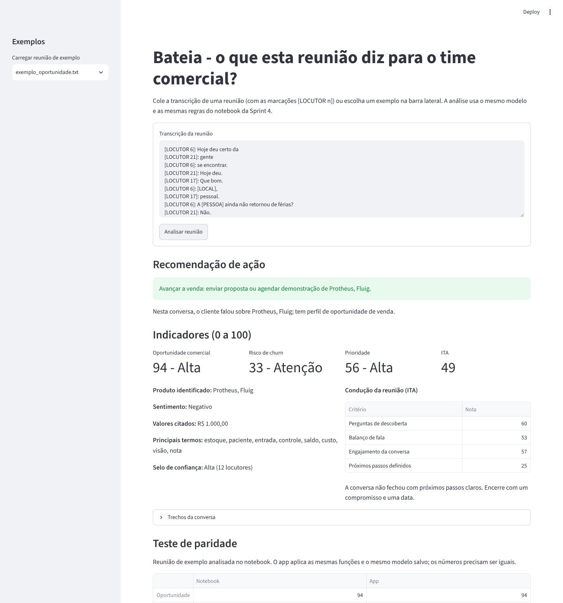

# Bateia - Sprint 4 de Data Science

Data Science & Statistical Computing - Challenge 2026 FIAP × TOTVS

Grupo: Enzo Augusto (RM562249), Gustavo Neres (RM561785), Rafaell Santiago (RM563486), Sebastian Iriarte (RM563619)

O Bateia lê as transcrições das reuniões comerciais da TOTVS e mostra ao time comercial o que apareceu em cada uma, para que os pontos mais importantes das conversas não se percam. Nesta sprint juntamos o que foi feito nas Sprints 1, 2 e 3 em uma solução que recebe uma transcrição nova e devolve, sozinha:

- produto TOTVS identificado;
- sentimento;
- risco de churn;
- oportunidade comercial;
- principais termos da reunião;
- recomendação de ação.

O fluxo segue a sugestão do Challenge: **Transcrição → Processamento → Modelo → Indicadores → Recomendação**. Os campos e as escalas (0 a 100) são os mesmos do app Bateia, para que o resultado possa ir direto para a tela de reunião e para a carteira de clientes.



## Estrutura do repositório

Todos os arquivos ficam na raiz, sem subpastas. O notebook e o app procuram os arquivos na mesma pasta em que estão.

```
Bateia_Sprint4_DataScience/
├── Bateia_Sprint4_DataScience.ipynb   notebook executado, com todas as saídas (Partes 1 a 7)
├── app_bateia.py                      app em Streamlit
├── requirements.txt                   bibliotecas
├── README.md
├── .gitignore
│
├── ANON_transcricao.json              transcrições anonimizadas da TOTVS (1.174 reuniões)
├── ANON_nome_transcricao.csv          mesmo conjunto com o campo TP_RECURSO (lead/customer)
├── reunioes_transcricoes_mockado.csv  base simulada do Challenge
│
├── modelo_oportunidade.joblib         modelo final (TF-IDF + Regressão Logística), gerado pelo notebook
├── tfidf_termos.joblib                TF-IDF dos principais termos, gerado pelo notebook
├── referencias.joblib                 dicionários e referências dos indicadores, gerado pelo notebook
├── paridade.csv                       resultado do notebook para o teste de paridade
├── exemplo_oportunidade.txt           reunião de exemplo usada no app (gerada pelo notebook)
├── exemplo_risco.txt                  reunião de exemplo usada no app (gerada pelo notebook)
└── app_bateia.png                     imagem do app usada neste README
```

Os três arquivos de dados são as entradas do notebook. Os arquivos `.joblib`, `paridade.csv` e os dois exemplos são saídas do notebook e entradas do app; eles já estão no repositório para o app rodar sem precisar executar o notebook antes.

## Como rodar

### 1. Baixar o projeto e criar o ambiente

Precisa de Python 3.10 ou mais novo.

```
git clone https://github.com/RafaellSantiagoMS/Bateia_Sprint4_DataScience.git
cd Bateia_Sprint4_DataScience

python -m venv venv
venv\Scripts\activate          # Windows
source venv/bin/activate       # Linux ou Mac

pip install -r requirements.txt
```

### 2. Notebook

**No computador (Jupyter ou VS Code).** Com o ambiente ativado, instale o Jupyter e abra o notebook na pasta do projeto:

```
pip install notebook
jupyter notebook Bateia_Sprint4_DataScience.ipynb
```

Execute as células em ordem (*Run All*). A execução completa leva uns 5 minutos. No final, o notebook recria os arquivos `.joblib`, o `paridade.csv` e os dois exemplos.

**No Google Colab.** Abra o notebook pelo Colab (*Arquivo > Abrir notebook > GitHub* e cole o link do repositório). O `ANON_transcricao.json` é baixado sozinho do Google Drive pela primeira célula de dados, como na Sprint 1 e 2. Os outros dois arquivos de dados (`ANON_nome_transcricao.csv` e `reunioes_transcricoes_mockado.csv`) precisam ser enviados pela aba *Arquivos*, à esquerda, antes de executar. A célula de dados mostra `ok` ou `FALTANDO` para cada um.

### 3. App

```
streamlit run app_bateia.py
```

O app abre no navegador. Escolha uma reunião de exemplo na barra lateral, ou cole uma transcrição com as marcações `[LOCUTOR n]`, e clique em **Analisar reunião**. O app não precisa dos arquivos de dados, só dos `.joblib`, do `paridade.csv` e dos exemplos.

O modelo salvo foi gerado com o `scikit-learn` da versão que está no `requirements.txt`. Se o notebook for executado de novo em outro ambiente, ajuste essa versão para a do ambiente que gerou os arquivos.

## O que tem no notebook

1. **Pipeline completo de processamento:** limpeza da Sprint 1, revisão dos dicionários da Sprint 2 (acentos, palavra inteira e termos genéricos), medição da conversa pelas marcações de locutor e principais termos por TF-IDF.
2. **Modelo final e justificativa:** Regressão Logística e Random Forest comparados por validação cruzada só no treino.
3. **Sistema de scoring:** oportunidade, risco de churn, ITA e prioridade de 0 a 100, sentimento e selo de confiança.
4. **Protótipo:** a função `analisar_reuniao`, os arquivos salvos com `joblib` e o app.
5. **Validação com novas transcrições:** teste guardado, 777 reuniões sem rótulo e base simulada.
6. **Recomendações de negócio:** ações sugeridas, carteira de clientes e visão por segmento.
7. **Limitações e próximos passos.**

## Protocolo

O rótulo `TP_RECURSO` (lead = oportunidade, customer = não oportunidade) só aparece em três momentos. Primeiro, 25% das 205 reuniões rotuladas são separadas como teste, com a mesma semente da Sprint 3, e ficam guardadas. Depois, o modelo é escolhido por validação cruzada estratificada de 5 folds só nos 75% de treino. Por último, o modelo escolhido é avaliado uma única vez no teste, e só então é treinado com as 205 reuniões para ir para o app. A limpeza, a revisão dos dicionários e as referências dos indicadores usam apenas o texto das reuniões, nunca o rótulo.

## Resultado

| Modelo | F1-macro (validação cruzada) | Recall de Oportunidade (validação cruzada) |
|---|---|---|
| Regressão Logística | 0,678 (± 0,047) | 0,620 (± 0,074) |
| Random Forest | 0,676 (± 0,077) | 0,575 (± 0,153) |
| Baseline (classe majoritária) | 0,362 | 0,000 |

Os dois modelos empatam no F1-macro. A Regressão Logística foi escolhida porque encontra mais oportunidades reais, varia menos entre os folds e mostra pelos coeficientes quais termos pesaram na decisão. No teste, o F1-macro foi de 0,606, o mesmo da Sprint 3. Na faixa Alta de oportunidade, 62% das reuniões do teste eram oportunidades reais, contra 29% na faixa Baixa.

O alerta de churn é feito por dicionário, porque a base não tem nenhum rótulo de cancelamento para treinar ou validar um modelo. Por isso ele funciona como aviso de que vale ler a reunião, e não como previsão.

## Teste de paridade

O app analisa o `exemplo_oportunidade.txt` e mostra os números ao lado dos que o notebook salvou no `paridade.csv`. Os dois dão oportunidade 94, risco 33, ITA 49 e prioridade 56.

## Limitações

O rótulo do CRM classifica o cliente, e não a reunião. São só 205 reuniões rotuladas. Não há rótulo de churn nem NPS real para validar o risco e o sentimento, e o ITA ainda não foi comparado com resultado de venda. Os detalhes estão na Parte 7 do notebook.
